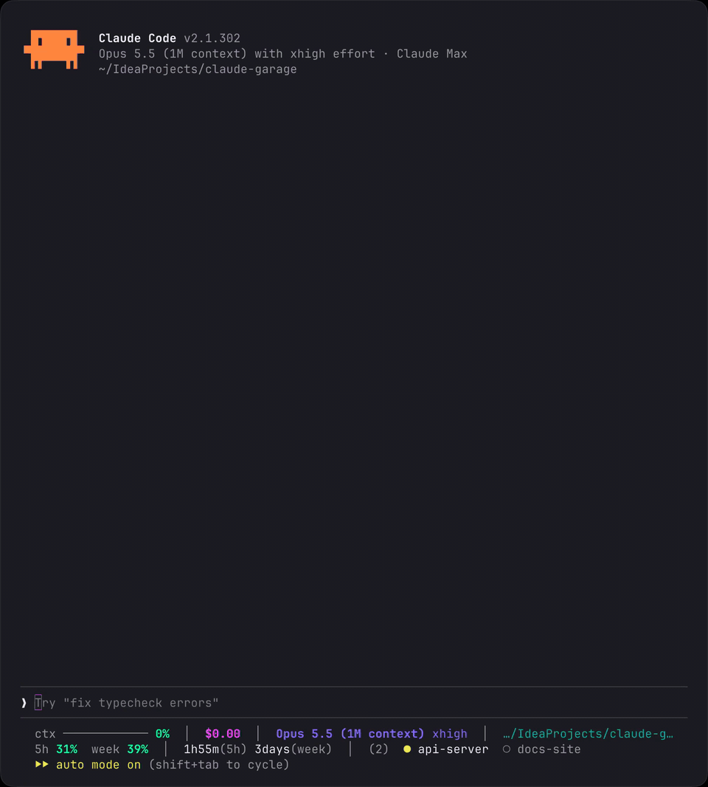
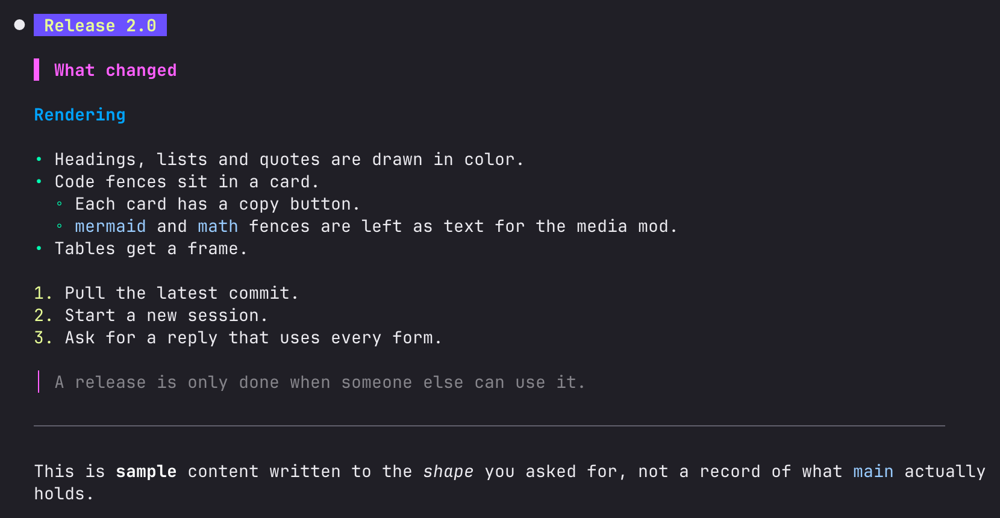
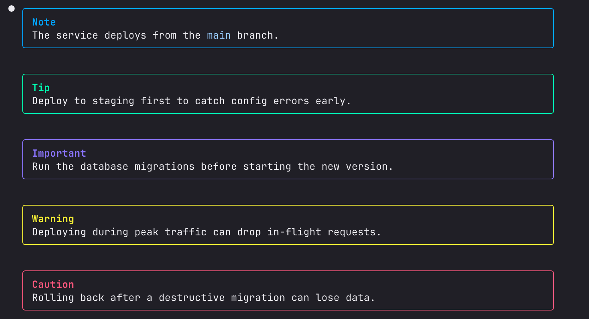
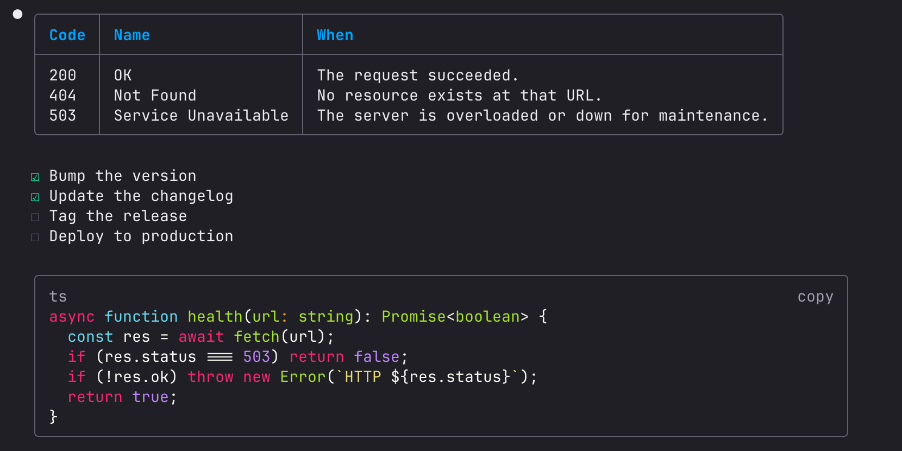

# NeonCoat

Mods and a status line for [Claude Code](https://claude.com/claude-code). A reply's diagrams, formulas, images and videos are drawn as pictures in the terminal, its markdown is drawn in color, and the status line says what the session is costing.



## What is in here

| Path | What it does |
| --- | --- |
| `mods/reply-media/` | Draws `mermaid` fences, formulas (`math` fences and `$$` blocks) and local images (`` on a line of its own) as pictures. A local video written as an image is drawn as its first frame with a play button, and plays in place. Under each picture, one button copies its source and one opens it larger in a pane. |
| `mods/reply-markdown/` | Draws headings, lists, task lists, quotes, callouts (`> [!WARNING]`), rules and tables in color, and puts each code fence in a card with a copy button. |
| `mods/skill-router/` | `/skill-router <question>` asks a small model which of your user-only skills fits the question. With no question it lists them. |
| `statusline.mjs` | The status line. First row: context used, cost, model, tokens per second, folder, cache hit rate, git state. Second row: subscription windows and when they refill, Remote Control, and the other sessions running on the machine. |

## What `reply-markdown` draws

Headings, lists, a quote, a rule, and bold, italic and inline code:



The five callouts:



A table, a task list, and a code fence as a card with its copy button:



## Requirements

- Claude Code with the mod API (function-hook plugins). The API is early access and may change under these mods. Last run on Claude Code 2.1.296.
- macOS. The picture scripts call `sips` and `open`.
- For `reply-media`, a terminal that speaks the kitty graphics protocol: Ghostty or kitty.
- Node.js, and for `reply-media`:

```bash
brew install librsvg ffmpeg
```

## Install

```bash
git clone https://github.com/NateCC0902/NeonCoat.git
cd NeonCoat/mods/reply-media/render && npm install
```

Then point `~/.claude/settings.json` at the clone. `CLAUDE_CODE_PLUGIN_DIRS` is colon-separated with one entry per mod (a parent folder is not scanned), so leave out the mods you do not want:

```json
{
  "env": {
    "CLAUDE_CODE_PLUGIN_DIRS": "/path/to/NeonCoat/mods/reply-media:/path/to/NeonCoat/mods/reply-markdown:/path/to/NeonCoat/mods/skill-router"
  },
  "statusLine": {
    "type": "command",
    "command": "node /path/to/NeonCoat/statusline.mjs",
    "padding": 0,
    "refreshInterval": 5
  }
}
```

The mods load in sessions started after that. These files are loaded live from the clone: a saved mod file hot-reloads in running sessions, so a broken edit breaks the terminal UI of all of them.

## Tell Claude what to write

`reply-media` draws only what Claude writes in the forms it knows: a `mermaid` fence, a `math` fence, an image on a line of its own. Claude does not write them unprompted, so add these notes to `~/.claude/CLAUDE.md`. The Formatting note does the same for the forms `reply-markdown` draws only when Claude chooses to write them.

````markdown
Diagrams:

Draw diagrams in replies as ```mermaid code fences, never as ASCII art. The reply-media mod turns each fence into a picture in the terminal.
Use only these types, the rest do not render: flowchart, stateDiagram-v2, sequenceDiagram, classDiagram, erDiagram, xychart-beta.
Start the fence at column 0: an indented fence (inside a list item or a quote) is not picked up.
Prefer flowchart LR: a TD chart with more than a few nodes fills the terminal's height.
Directory trees and tables are not diagrams: keep them as text.

Math:

Write a formula that stands on a line of its own as LaTeX in a ```math code fence, one formula per fence, starting at column 0. The same mod turns it into a picture. Leave out `\tag`: a tagged formula is not drawn.
Write math inside a sentence in Unicode (a⃗ · b⃗ = |a||b|cos θ), never as `$x$`: a picture cannot sit inside a line of text.

Images:

To show an image file from this machine, write `` on a line of its own, starting at column 0. The same mod draws it. The path is absolute, under `~/`, or relative to the session's working directory. An image at a URL is not fetched, so give its link as text.
A video file (mp4, mov, webm, mkv, gif) written the same way is shown as its first frame with a play button.

Formatting:

For a warning or a note I must not miss, write a GitHub alert: a quote whose first line is `[!NOTE]`, `[!TIP]`, `[!IMPORTANT]`, `[!WARNING]` or `[!CAUTION]`. It becomes a colored box.
For steps or checks to tick off, write a task list: `- [ ]` and `- [x]`.
Put a command or snippet I will copy in a code fence of its own, with its language, not in inline code: the fence gets a copy button.
````

## Options

Each mod's options are rows in `/config`, and a change takes effect at once.

| Mod | Option | Default | What it changes |
| --- | --- | --- | --- |
| all three | `enabled` | `true` | Turns the mod off without removing it. |
| `reply-media` | `pxPerColumn` | `8` | Pixels of a picture per terminal column. Lower draws pictures larger. |
| `reply-media` | `cellAspect` | `2.17` | How many times taller than wide one terminal cell is. Change it when pictures look squashed or stretched. |
| `reply-media` | `resumedReplies` | `3` | How many of a resumed session's last replies get their pictures drawn again. |
| `reply-markdown` | `tableBorder` | `bold` | `round`, `single` or `bold`. |
| `reply-markdown` | `cardBorder` | `round` | The border of a code card and of a callout box: `round`, `single` or `bold`. |

## Colors

The colors are written into the code to match one dark theme, which is not in this repo. For another theme, edit the constants at the top of each file: `COLORS` in `statusline.mjs`, `COLOR` and `CALLOUT` in `mods/reply-markdown/hooks/register.tsx`, and `THEME` in `mods/reply-media/render/render.mjs`.

## Checks

Run these after a change, from the repo's root:

```bash
claude plugin validate mods/<name> && claude plugin test mods/<name>
npx -p typescript tsc -p mods/<name>
(cd mods/reply-media/render && npm test)
echo '{}' | node statusline.mjs && node --test statusline.test.mjs
```

The types check works once Claude Code has loaded the mod and written its types to `mods/<name>/.claude-plugin/types/`. `CLAUDE.md` has the notes for changing or adding a mod.
